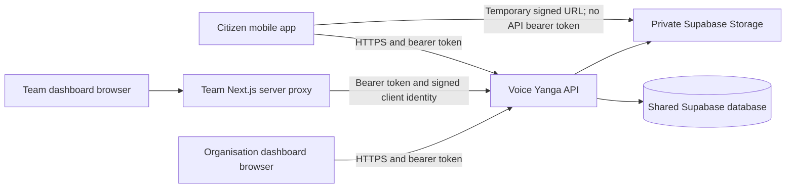

# Voice Yanga mobile, live API, and dashboard integration contract

**Contract version:** 1.0  
**Snapshot date:** 3 October 2026 (Africa/Lusaka)  
**Repository baseline:** `a92ce9f`  
**Audience:** the mobile developer, API maintainer, dashboard developer, and pilot tester  
**Scope:** the existing citizen mobile experience, its shared API, and the two deployed dashboards.

This is an implementation handoff, not a proposal for a replacement API. It records actual handlers, schemas, permissions, serializers, and pilot configuration. **MUST** describes a required client integration rule. **SHOULD** describes a recommended client behaviour. **CURRENT LIMITATION** identifies a backend or product gap; it is not a capability the mobile app can assume already exists.

The API source under `src/` and `prisma/` had no differences from deployment-source commit `d991b64` when reviewed. That source was redeployed with the organisation dashboard's CORS origin. This document does not change runtime behaviour.

## Contents

1. [Deployment addresses and system boundaries](#1-deployment-addresses-and-system-boundaries)
2. [Pilot capabilities and disabled flows](#2-pilot-capabilities-and-disabled-flows)
3. [HTTP, identifiers, dates, and response parsing](#3-http-identifiers-dates-and-response-parsing)
4. [Authentication and account lifecycle](#4-authentication-and-account-lifecycle)
5. [Reference data and location selection](#5-reference-data-and-location-selection)
6. [Complaint creation and offline submission](#6-complaint-creation-and-offline-submission)
7. [Complaint reading and data models](#7-complaint-reading-and-data-models)
8. [Comments, support, and history](#8-comments-support-and-history)
9. [Photos, voice notes, and private media](#9-photos-voice-notes-and-private-media)
10. [Notifications and future push delivery](#10-notifications-and-future-push-delivery)
11. [Shared complaint lifecycle and dashboard actions](#11-shared-complaint-lifecycle-and-dashboard-actions)
12. [Roles, permissions, and visibility](#12-roles-permissions-and-visibility)
13. [Mobile analytics instrumentation](#13-mobile-analytics-instrumentation)
14. [Errors, retries, and failure recovery](#14-errors-retries-and-failure-recovery)
15. [Mobile implementation work packages](#15-mobile-implementation-work-packages)
16. [Live acceptance test contract](#16-live-acceptance-test-contract)
17. [Known backend gaps and change control](#17-known-backend-gaps-and-change-control)
18. [Source references and verification evidence](#18-source-references-and-verification-evidence)

## 1. Deployment addresses and system boundaries

| Purpose | Address |
| --- | --- |
| API origin | `https://voice-yanga-api.vercel.app` |
| API base URL | `https://voice-yanga-api.vercel.app/api/v1` |
| Base URL for clients requiring a trailing slash, such as Retrofit | `https://voice-yanga-api.vercel.app/api/v1/` |
| Team dashboard | `https://voice-yanga-team-dashboard.vercel.app` |
| Organisation dashboard | `https://voice-yanga-organisation-dashboard.vercel.app` |
| Swagger UI | `https://voice-yanga-api.vercel.app/api-docs/` |
| OpenAPI JSON | `https://voice-yanga-api.vercel.app/api-docs.json` |
| API health | `https://voice-yanga-api.vercel.app/health` |
| Database readiness | `https://voice-yanga-api.vercel.app/ready` |

Except where labelled **root origin**, endpoint paths below are appended to `/api/v1`.



The mobile app MUST:

- Call the API directly. It MUST NOT submit complaints to either dashboard's domain or to the team dashboard's `/api/*` proxy.
- Use the same API deployment as both dashboards. There is no separate mobile database or dashboard synchronisation endpoint.
- Keep API-origin configuration separate from API-base-path configuration: `/uploads/...` is relative to the origin, not `/api/v1`.
- Keep access and refresh tokens in platform-protected storage. It MUST NOT contain database credentials, Supabase service-role keys, JWT signing secrets, SMTP credentials, cron secrets, or `TEAM_DASHBOARD_PROXY_SECRET`.
- Send bearer authentication only to the configured API origin. Do not forward it to signed storage URLs, arbitrary photo URLs, analytics providers, or dashboard pages.
- Treat dashboard sessions as independent. Opening a dashboard link requires a dashboard login; there is no implemented cross-app SSO/token handoff.
- Use server UUIDs in links: team `/issues/{id}`; organisation `/complaints/{id}`. A reference code such as `VY-...` is for display/search, not the route ID.
- Avoid hardcoding Vercel's generated deployment URLs. Use the stable addresses above.

Native HTTP requests normally omit `Origin`. Do not invent a dashboard `Origin` header. Browser/WebView/hybrid requests that send an origin must use an explicitly approved API CORS origin. The current list includes the API origin and organisation dashboard origin. It does not automatically allow arbitrary mobile WebView origins.

Do not send `x-vy-client-*` assertions or spoof Vercel IP headers. Those are the trusted team server proxy's responsibility.

## 2. Pilot capabilities and disabled flows

| Capability | Current contract |
| --- | --- |
| Citizen email/phone + password registration | Implemented; creates a `CITIZEN` and returns tokens. No OTP/email verification step is required by this route. |
| Citizen login, own/community complaints, comments, support | Implemented. Apply the visibility distinctions in section 12. |
| Staff accounts | Provisioned by an administrator. Public citizen signup cannot create staff/admin roles. |
| In-app notifications | Stored synchronously with relevant complaint transactions; available through the API without an email provider or scheduler. |
| Email delivery | `EMAIL_ENABLED=false`. |
| Password-reset request | Returns `503 EMAIL_DISABLED`. Even after enabling email, the request service still needs actual reset-email sending implemented. |
| Organisation public registration / resend verification / application approval | Email-dependent and currently blocked. Manual administrator organisation/user creation remains available. |
| Firebase push | `FCM_ENABLED=false`. Do not promise notifications while the app is closed. |
| Notification delivery worker | Disabled in the pilot deployment; external scheduler not configured. |
| Expired voice-note cleanup | HTTP job exists, but no scheduler is active. Logical expiry still applies when consuming a voice note. |
| Report schedules | Schedule records can be stored; automated report generation/delivery is not implemented. |
| AI, forecasting, offline dashboard, real-time subscriptions | Not operational. Feature flags are not evidence of implementation. |
| Retention analytics | The team growth endpoint explicitly reports that retention is unavailable pending mobile session instrumentation. Sending events alone does not complete the aggregation. |
| Mobile offline drafts | The mobile app must implement these locally. The API only supplies complaint-create deduplication via `clientUuid`. |

The mobile client SHOULD keep a pilot capability configuration, e.g. `emailRecoveryAvailable=false` and `pushDeliveryAvailable=false`. These are **client configuration suggestions**, not an existing API capability endpoint. `GET /features` does not advertise SMTP, FCM, or scheduler readiness.

Show disabled recovery/onboarding clearly. Never display “email sent” after an error response.

## 3. HTTP, identifiers, dates, and response parsing

### 3.1 Request conventions

```http
Authorization: Bearer <access-token>
Accept: application/json
Content-Type: application/json
```

Use JSON for ordinary request bodies. For uploads, use the HTTP library's multipart builder and let it generate the boundary; do not manually set a bare `multipart/form-data` header. Never base64-encode photos/audio into complaint JSON.

Do not prefix `Bearer` twice. Send the **access** token in the header; refresh tokens belong only in the appropriate JSON request body.

IDs are strings. Use distinct model fields:

| Identifier | Meaning |
| --- | --- |
| `clientUuid` | Client-generated random UUID, created once per local complaint draft and reused for retries. |
| `serverId` | UUID returned by complaint creation. |
| `id` | The same server complaint UUID in list/detail objects. |
| `referenceCode` | Human-readable server reference; not the URL ID. |
| `mediaId` / media `id` | UUID used to request private-media access. |
| `notification.id` | UUID for read state. Not a complaint ID. |

### 3.2 Success responses are deliberately documented per endpoint

Do not install a universal decoder that assumes every success response has `data`.

| Endpoint family | Wire shape |
| --- | --- |
| Register / login | `{ token, refreshToken, user }` |
| Refresh | `{ success: true, data: { accessToken, refreshToken } }` |
| GET profile | Flat profile object |
| PATCH profile | `{ success: true, data: <user record> }` |
| POST complaint | `{ serverId, referenceCode, status, syncStatus }` |
| Complaint list / own list / notification list | `{ success: true, data: { data: [...], meta: {...} } }` |
| Complaint detail / state mutation | `{ success: true, data: <complaint> }` |
| GET comments | Bare array |
| POST comment | `{ success: true, data: <raw comment> }` |
| Support | `{ newSupportCount }` |
| Categories / locations / complaint history | `{ success: true, data: [...] }` |
| Voice-note upload | `{ success: true, data: { fileUrl, durationSeconds, mimeType } }` |
| Legacy photo upload | `{ photoUrl }` |
| Logout / notification read actions | `{ success: true, message }` |
| Health / readiness | Root-level system objects, not standard API envelopes |

Pagination is **zero-indexed**:

```json
{
  "success": true,
  "data": {
    "data": [],
    "meta": {
      "totalItems": 0,
      "totalPages": 0,
      "page": 0,
      "limit": 20
    }
  }
}
```

Request `page=0` first. Default limit is 20; allowed limit is 1–100. Read `response.data.data` and `response.data.meta`. Refresh page zero after writes; concurrent updates can move records between offset-based pages. Deduplicate cached list entries by `id`.

### 3.3 Date and nullable-field contract

The API currently mixes epoch milliseconds and ISO strings. A mobile DTO adapter MUST handle this intentionally.

| Field | Current wire representation |
| --- | --- |
| Complaint `createdAt`, `updatedAt`, `slaDueAt` | Epoch milliseconds, JSON number |
| Complaint `assignedAt`, `assignmentAcceptedAt` | Epoch milliseconds or null |
| GET comments `createdAt` | Epoch milliseconds |
| Complaint history `createdAt` | Epoch milliseconds |
| GET profile `createdAt` | ISO 8601 string |
| Notification `createdAt` | ISO 8601 string |
| Raw media, POST-comment dates, category/location dates, nested database records | ISO 8601 strings where present |
| GET notification preference dates | Raw ISO strings where present |
| PATCH notification preferences `updatedAt` | Epoch milliseconds |
| Error `timestamp` | ISO 8601 string |
| Complaint list `dateFrom` / `dateTo` | ISO 8601 query strings with timezone offset |
| Analytics event `occurredAt` | Send ISO 8601 UTC; schema coerces to a date |

Use 64-bit integers for epoch milliseconds; never Android/Java `int`. Do not multiply milliseconds by 1,000. Keep UTC internally and format locally for display; the dashboards use Africa/Lusaka where specified.

Missing and null optional fields are not empty objects. In particular, complaints can have no assignee, no organisation, no acceptance time, and no media. Ignore unknown response fields for forward compatibility. Handle unknown enum values with a safe display fallback rather than crashing.

## 4. Authentication and account lifecycle

### 4.1 Registration: `POST /auth/register` → 201

```json
{
  "firstName": "Pilot",
  "lastName": "Citizen",
  "email": "pilot.citizen@example.invalid",
  "phone": "+260970000000",
  "password": "<user-chosen-password-with-at-least-1-digit>"
}
```

Illustrative only: use a real test user's own contact details when testing.

| Field | Validation |
| --- | --- |
| `firstName`, `lastName` | Required, 1–80 characters each |
| `email` | Optional valid email, maximum 150; omit if unused |
| `phone` | Optional string, maximum 20; omit if unused |
| Contact rule | At least one of email or phone |
| `password` | At least 8 characters and at least one digit |

Do not send empty `email` as a substitute for an omitted optional value. Normalise phone formatting consistently on registration/login; do not assume the API automatically rewrites local numbers to international format.

The server determines the role. Sending `role`, `organizationId`, permissions, or a verification status cannot provision a staff account through this schema.

Response:

```json
{
  "token": "<access-token>",
  "refreshToken": "<refresh-token>",
  "user": {
    "id": "30000000-0000-4000-8000-000000000010",
    "role": "CITIZEN",
    "name": "Pilot Citizen",
    "email": "pilot.citizen@example.invalid",
    "phone": "+260970000000",
    "permissions": []
  }
}
```

### 4.2 Login: `POST /auth/login` → 200

```json
{
  "identifier": "pilot.citizen@example.invalid",
  "password": "<password>"
}
```

`identifier` accepts the registered email or phone. The response has the same flat shape as registration. Persist `token` as the mobile access token. Do not look for `data.token` or `accessToken` in this response.

A citizen mobile build SHOULD check `user.role` after login. If staff access is outside its scope, explain that the account uses a dashboard and clear/revoke the newly established mobile session; do not expose staff controls accidentally.

### 4.3 Refresh: `POST /auth/refresh` → 200

```json
{ "refreshToken": "<current-refresh-token>" }
```

```json
{
  "success": true,
  "data": {
    "accessToken": "<new-access-token>",
    "refreshToken": "<new-refresh-token>"
  }
}
```

The pilot uses the schema defaults of approximately **15 minutes** for access tokens and **7 days** for refresh tokens. Follow the JWT expiry/current API response, not a permanently hardcoded timer.

The server rotates refresh tokens. The client MUST:

1. Use a single shared refresh operation when concurrent API calls fail due to token expiry.
2. Atomically replace **both** tokens on success.
3. Retry each original request at most once after successful refresh.
4. Never route login, registration, refresh, or logout failures into an endless refresh loop.
5. On a definitive invalid/revoked refresh response, clear the session and request login.
6. On a network error or 5xx during refresh, preserve recoverable local drafts and do not misreport “wrong password.” Retrying refresh after a lost response may fail because the previous token could already have rotated; offer reauthentication.
7. Scope queues/caches to the authenticated user ID. Signing into a different account must not submit the previous user's queued complaints.

### 4.4 Logout: `POST /auth/logout` → 200

Body: `{ "refreshToken": "<current-refresh-token>" }`. Response: `{ "success": true, "message": "Logged out successfully" }`.

Attempt server revocation, then clear local tokens and authenticated cached data. Explain an offline failure without leaving the UI apparently signed in. Existing access JWTs are not a separately managed device-session revocation system; server logout revokes the supplied refresh token.

### 4.5 Profile

| Method/path | Body and result |
| --- | --- |
| `GET /users/profile` | Bearer required. Returns flat `{ id, name, email, phone, role, permissions, createdAt }`. |
| `PATCH /users/profile` | Bearer required. Accepts any non-empty subset of the fields below. Returns an envelope containing a raw user record with `firstName`/`lastName`. |
| `DELETE /users/profile` | Citizen-only self-deletion enforced in the service. Returns `{ success: true, data: { message: "Account deleted permanently" } }`. |

Profile PATCH fields:

- `firstName` / `lastName`: 1–80 characters.
- `phone`: maximum 20 characters.
- `locationId`: UUID from reference data.
- `fcmToken`: maximum 255 characters; stores a device token for future push enablement.

Email, password, role, and organisation are not accepted self-profile update fields. Null is not accepted for the optional string/UUID fields in this schema. GET profile does not return a reliable round-trip representation of every PATCH field: notably it omits `locationId` and `organizationId`. Do not invent these fields in its DTO.

Account deletion is destructive: it deletes the citizen and their complaints, associated records, and linked stored files as implemented. Require an explicit confirmation UI; after success, clear credentials, local drafts, attachments, cached media, and queued work for that account. This is not an “archive account” action. Do not execute this endpoint in routine smoke testing.

### 4.6 Password recovery

- `POST /auth/password-reset/request` accepts `{ "email": "..." }`.
- Current expected result: `503 EMAIL_DISABLED`.
- `POST /auth/password-reset/confirm` accepts `{ "token": "...", "newPassword": "..." }` with the registration password rule.
- Valid reset tokens are single-use, expire after 30 minutes, and confirmation revokes refresh sessions.
- The confirm endpoint does not create a usable email channel. The request handler presently creates tokens without sending reset email when enabled. Keep the normal recovery journey unavailable until this gap is implemented and verified.
- No implemented SMS OTP or MFA flow should be added to the client UI as though the API supports it.

## 5. Reference data and location selection

### 5.1 Endpoints

| Endpoint | Auth | Response |
| --- | --- | --- |
| `GET /categories` | Public | `{ success: true, data: Category[] }`, active categories |
| `GET /locations` | Public | `{ success: true, data: Location[] }` |
| `GET /locations?search=Matero` | Public | Filtered location array |
| `GET /locations/{id}` | Bearer | Envelope with one location |

Category fields include `id`, `name`, `isActive`, `createdAt`, `updatedAt`. Location fields include `id`, `province`, `district`, nullable `constituency`/`ward`/coordinates, and `createdAt`.

The location list uses the first supplied search selector in this order: `ward`, `district`, `search`. These are search terms, not a combined exact-filter contract.

Cache reference data for selection, but refresh on app start/foreground and before retrying reference-data validation failures. Do not hardcode the seed category/location IDs into the production app.

### 5.2 Important creation mismatch

Complaint creation currently accepts:

- `category` = category **name**.
- `location` = location **text**.

It does **not** accept `categoryId`, `locationId`, latitude, or longitude as creation fields. Those unknown fields can be stripped by validation rather than producing the desired routing.

The category lookup matches its name. Location lookup uses a case-insensitive substring search across ward, constituency, or district and returns the first match. If nothing matches, the current implementation falls back to the first database location.

**CURRENT LIMITATION — routing ambiguity:** a mobile picker cannot guarantee deterministic routing for duplicate or overlapping location names. For the controlled pilot:

1. Select from `GET /locations`, retaining the selected ID locally.
2. Send a specific, uniquely matching ward/constituency value, verified for the pilot data. Do not send an arbitrary GPS label or a concatenated address that the lookup cannot match.
3. After creation, fetch the complaint and compare its `locationId` to the selected ID.
4. If they differ, flag the mismatch and stop claiming correct organisation routing; the current mobile API has no complaint-location correction endpoint.
5. Before broad rollout, change the backend to accept explicit location/category IDs and reject unknown/ambiguous locations. That requires a separately versioned API change, not an undocumented client workaround.

The organisation that receives visibility is determined by the resolved complaint location. The creation payload does not assign an organisation or official.

## 6. Complaint creation and offline submission

### 6.1 `POST /complaints` → 201, citizen only

Supports JSON or multipart. For JSON:

```json
{
  "title": "Water pipe leaking near the market",
  "description": "Water has been flowing onto the footpath since this morning.",
  "category": "Water",
  "location": "Matero Ward 1",
  "priority": "MEDIUM",
  "clientUuid": "70000000-0000-4000-8000-000000000001"
}
```

Names are illustrative; resolve current reference data first.

| Field | Rule |
| --- | --- |
| `title` | Required, 5–150 characters |
| `description` | Trimmed; maximum 10,000 characters. At least 10 characters unless a valid uploaded voice note is supplied. Defaults to empty. |
| `category` | Required non-empty category name |
| `location` | Required non-empty location text; see section 5 |
| `priority` | Optional `LOW` / `MEDIUM` / `HIGH` / `CRITICAL`; defaults to `MEDIUM` |
| `clientUuid` | Technically optional string; this mobile contract requires a random UUID created once per draft |
| `createdAt` | Optional JSON number, epoch milliseconds. Omit for server submission time; never send seconds. |
| `voiceNoteUrl` | Optional exact `/uploads/...` value from this user's valid pending voice upload |
| `voiceNoteDurationSeconds` | Required together with `voiceNoteUrl`; integer 1–120; must equal the recorded pending upload duration |
| `photoUrls` | Legacy JSON-only compatibility: at most 5 HTTPS URLs. Prefer managed uploads; see section 9. |
| `authorEmail` | Optional valid email accepted by validation; it does not determine authorship. The authenticated user is the reporter. |

Successful response, including a recognised duplicate retry:

```json
{
  "serverId": "50000000-0000-4000-8000-000000000010",
  "referenceCode": "VY-2026-000010",
  "status": "SUBMITTED",
  "syncStatus": "SYNCED"
}
```

A duplicate retry can return the complaint's **current** status, such as `IN_PROGRESS`, rather than `SUBMITTED`. Treat `syncStatus` as submission acknowledgement, not the complaint workflow state.

For multipart, send repeated file parts named **`photos`**, maximum 5, and ordinary text fields for title/description/category/location/priority/clientUuid. The aggregate image budget applies to all five combined.

**Multipart numeric caveat:** `voiceNoteDurationSeconds` is coerced from multipart text. `createdAt` is a strict number and is not coerced; omit it in multipart requests. If preserving a verified offline occurrence time is essential, create with JSON and upload photos afterwards, or implement a separately reviewed backend coercion change.

Do not add a JSON field called `payload` and expect the API to unpack it.

### 6.2 Local queue and idempotency requirements

Recommended local states are `DRAFT`, `PENDING`, `UPLOADING_VOICE`, `SUBMITTING`, `SYNCED`, `RETRYABLE_ERROR`, and `NEEDS_USER_ACTION`. These are mobile-only states, not server enums.

Persist at least:

- Owner user ID and `clientUuid`.
- Original form values and selected reference-data IDs.
- Durable local copies/permissions for queued media; a temporary picker URI alone may not survive restart.
- Voice upload URL/duration/expiry estimate if already uploaded.
- `serverId` and `referenceCode` once acknowledged.
- Last failure code, retry count, and timestamps; never plaintext passwords or logged tokens.

Submission sequence:

1. Validate local fields and actual encoded file sizes.
2. Ensure the correct account is signed in.
3. Upload a voice note first when needed; retain the returned relative path and exact duration.
4. Submit JSON or multipart with the existing `clientUuid`.
5. On 201, atomically persist the server ID/reference and mark submission synced.
6. Fetch `GET /complaints/{serverId}`, verify location, and replace display fields with server values.
7. For two-stage photo submission, separately track which attachments are confirmed. Do not label incomplete evidence “fully uploaded.”

After a timeout or lost create response, retry with the **same clientUuid and same draft**. The server uses it to find an existing complaint; it does not update that complaint with edited retry content. Do not create a new UUID merely because the first request timed out.

**CURRENT LIMITATION:** the idempotency lookup is globally keyed by `clientUuid` and is not checked against reporter ownership at that lookup. Use high-entropy UUIDs, never shared/static IDs, and isolate drafts by account. Backend owner binding is required hardening; client discipline is not a substitute.

Do not replay comment posts, media uploads, or every other mutation using this deduplication assumption. They do not share complaint-create idempotency.

If voice upload itself loses its response, `GET /voice-notes` can list that user's unexpired pending uploads. If the app cannot confidently identify the uploaded note, retain the local audio and let the user retry; don't attach another user's or an expired note.

`createdAt` supplied by the client affects server SLA calculation. Validate clock/time units, and prefer omitting it for ordinary online submissions. Do not forge older/newer times to manipulate SLA.

## 7. Complaint reading and data models

### 7.1 Read endpoints

| Endpoint | Meaning |
| --- | --- |
| `GET /complaints/my` | Citizen's own complaints; use for “My reports” and offline-sync reconciliation |
| `GET /complaints` | Citizen community feed; staff location-scoped list; global administrator list |
| `GET /complaints/{id}` | Detail by server UUID |
| `GET /complaints/{id}/history` | History, with stricter ownership/scope than community detail |
| `GET /complaints/{id}/comments` | Citizen-visible comments for citizens |
| `GET /complaints/{id}/media/{mediaId}/access` | Authorised media access URL |

Both list endpoints accept:

| Query | Values |
| --- | --- |
| `page` / `limit` | Zero-based integer / 1–100 |
| `status` | One exact status enum |
| `priority` | One exact priority enum |
| `categoryId` / `locationId` | UUID |
| `category` | Category name, trimmed, maximum 100 |
| `ward` / `district` / `province` | Trimmed text, maximum 150 each |
| `dateFrom` / `dateTo` | ISO datetime with offset; filters complaint creation time |
| `search` | Searches title, description, and reference code |
| `sortBy` | `createdAt` / `updatedAt` / `priority` / `status` |
| `sortOrder` | `asc` / `desc`; default `desc` |

There is no mobile `since`/delta-sync endpoint, server-side draft endpoint, arbitrary complaint edit endpoint, or direct `GET by clientUuid` endpoint. Reconcile through acknowledged server IDs, same-UUID creation retries, and own-list pagination. A search parameter is not an exact idempotency-key lookup.

### 7.2 Complaint DTO

The same presenter is used for list and detail. Consume these fields:

| Field | Meaning/type |
| --- | --- |
| `id`, `referenceCode`, `userId` | Server identifiers |
| `clientUuid` | Nullable client correlation key |
| `title`, `description` | Text; description can be empty on voice-led reports |
| `status`, `priority` | Exact enums; see section 11 |
| `supportCount` | Integer |
| `categoryId`, `locationId` | Resolved IDs |
| `category` | Category object |
| `location` | Location object |
| `reporter` | `{ id, firstName, lastName }` where present |
| `media` | Array of stored complaint media |
| `createdAt`, `updatedAt`, `slaDueAt` | Epoch milliseconds |
| `isOverdue` | Server-computed boolean |
| `assignedTo` | Nullable staff object; use its ID/name rather than inventing a separate assignee field |
| `organization` | Nullable organisation derived from the active assignee, not necessarily the only organisation that can see the complaint |
| `assignedAt`, `assignmentAcceptedAt`, `assignmentId` | Nullable assignment metadata |

Media records contain `id`, `complaintId`, `fileUrl`, `type`, `uploadedBy`, and may contain `storageKey`, `mimeType`, `sizeBytes`, `checksumSha256`, `durationSeconds` and date fields. Some legacy metadata is null. Do not treat a returned storage key as permission to access the bucket directly.

The embedded raw `assignments` relation is transformed into top-level assignment fields. Do not rely on an `assignments[0]` wire field.

### 7.3 Refresh and dashboard consistency

There is no server push subscription for complaint updates. The app SHOULD refetch:

- When entering a complaint detail screen.
- When returning to the foreground.
- After submitting, posting a comment, supporting, uploading, or opening a notification.
- On explicit pull-to-refresh.
- Optionally at a modest interval while an active detail screen is visible; use backoff and stop in the background.

Do not assume the organisation or team dashboard automatically refreshes its queue at the instant the mobile submission completes. Navigation, actions, or manual refresh may be needed.

One acknowledged server ID identifies the same complaint in all three clients. A displayed status must come from a fresh API read, not from the mobile's last local workflow assumption.

## 8. Comments, support, and history

### 8.1 Citizen comment: `POST /complaints/{id}/comments` → 201

```json
{
  "message": "The leak is still affecting the footpath.",
  "isCitizenVisible": true
}
```

`message` is 1–2,000 characters. `isCitizenVisible` is a JSON boolean and defaults to true.

A citizen can post to their own complaint. Reading a community complaint does not grant permission to post to it. The mobile citizen UI MUST always send true and MUST NOT offer an “internal staff note” control.

Response is an envelope containing the raw comment fields, including `message` and `isCitizenVisible`, not the same DTO as the read list. Refetch the read list after success or explicitly normalise the mutation response.

### 8.2 Read comments: `GET /complaints/{id}/comments` → 200

Returns a **bare array**, ordered oldest first:

```json
[
  {
    "id": "60000000-0000-4000-8000-000000000010",
    "authorName": "Example Official",
    "content": "Our team is investigating this report.",
    "isOfficial": false,
    "createdAt": 1791021600000
  }
]
```

**Compatibility trap:** `isOfficial` is currently calculated as `!isCitizenVisible`, not from the author's role. Public staff replies therefore also have `isOfficial=false`. Do not use it to label “verified official” authors. Citizen responses exclude internal comments.

There is no comment-edit/delete contract or comment idempotency key. Do not automatically replay a timed-out comment POST indefinitely.

### 8.3 Support: `POST /complaints/{id}/support` → 200

Citizen bearer token; no business fields required in the body.

```json
{ "newSupportCount": 4 }
```

A second support by the same user produces `409 ALREADY_VOTED`. This is not a toggle: there is no un-support endpoint. Refetch the count rather than incrementing again. The complaint DTO does not include a reliable `supportedByMe` flag; a locally remembered vote is only a hint, and 409 is authoritative.

### 8.4 History: `GET /complaints/{id}/history` → 200

```json
{
  "success": true,
  "data": [
    {
      "id": "80000000-0000-4000-8000-000000000010",
      "action": "STATUS_CHANGE",
      "title": "Status updated",
      "actorName": "Example Official",
      "oldValue": { "status": "REVIEWED" },
      "newValue": { "status": "VERIFIED" },
      "createdAt": 1791021600000
    }
  ]
}
```

`oldValue` and `newValue` can be null or vary by action. Do not map every event to one fixed status DTO. The route returns an array with a server-side history cap; it is not a public cursor-based event stream or a paginated audit export.

Citizens can fetch history for their own complaints. A community complaint's readable detail/comments/media do not guarantee access to its history.

## 9. Photos, voice notes, and private media

### 9.1 Exact pilot limits

These values were checked in the local production deployment configuration and corresponding API schema:

| Limit | Value |
| --- | --- |
| Each image file | At most **4,000,000 bytes** |
| Each audio file | At most **4,000,000 bytes** |
| Sum of uploaded files in one request | At most **4,000,000 bytes**, inclusive |
| Entire multipart request, including fields/boundaries | At most **4,250,000 bytes**, inclusive |
| Inline complaint photos | At most 5, all combined within the aggregate budget |
| Voice duration | Integer 1–120 seconds |
| Voice-note pending validity | 24 hours after upload, until consumed |
| Signed-media URL default validity | 3,600 seconds; obey returned expiry information |

“4 MB” here means 4,000,000 bytes, **not** 4 × 1,024 × 1,024. It is a maximum, not a required target file size.

For example, three photos of 1,500,000 bytes each fail the aggregate limit although each file is below 4 MB. A separate voice upload has its own per-request budget. These limits do not imply a lifetime 4 MB quota for every attachment ever added to a complaint.

The client MUST inspect/compress the encoded files before sending, retain the user's draft after rejection, and display a useful error. Do not pad files to exactly 4 MB. Prefer a smaller compression target to leave practical network and encoding headroom.

Allowed image MIME types: `image/jpeg`, `image/png`, `image/webp`. HEIC/HEIF, GIF, SVG, PDF, and video are not complaint photo formats; transcode supported mobile camera formats to a permitted image format.

Allowed voice MIME types: `audio/mp4`, `audio/m4a`, `audio/aac`, `audio/mpeg`, `audio/ogg`, `audio/webm`, `audio/wav`, `audio/x-wav`. Use a matching filename/content type and a real supported audio container. Sending `application/octet-stream` will not satisfy the audio filter.

Do not gzip multipart requests. Compressed multipart bodies are rejected with `415 UNSUPPORTED_ENCODING`.

### 9.2 Preferred photo flows

**Flow A — inline photos:** `POST /complaints` multipart, file field `photos` repeated up to five times. This creates the complaint and attaches the images in the request's workflow.

**Flow B — attach after creation:** `POST /complaints/{id}/media` multipart:

| Part | Value |
| --- | --- |
| `file` | One image |
| `type` | `PHOTO` for citizen evidence |

Success: `201 { success: true, data: <raw media record> }`. Then refetch complaint detail.

Staff resolution evidence uses the same endpoint with `type=PROOF_OF_RESOLUTION`. Mobile citizens MUST NOT offer this staff action. The current backend media route has access checks but no separate staff-role gate specifically for that type; enforcing that distinction server-side is listed in section 17.

There is no supported post-creation voice attachment through this image-only endpoint.

**Legacy photo flow:** `POST /photos/upload` multipart accepts `file` and `complaintUuid`. The complaint must already exist; the value may match server `id` or `clientUuid`. Returns `201 { photoUrl: "/uploads/..." }` and has already attached the photo. Do not attach its result a second time.

`GET /photos?complaintId={serverId}` returns `{ success: true, data: [...] }` for `PHOTO` records with stricter complaint ownership/scope checks. It does not return all media types.

**Legacy URL caveat:** JSON `photoUrls` only accepts HTTPS URLs. Managed `/uploads/...` paths returned by `/photos/upload` are not valid values for this field. Do not convert a temporary signed URL to a permanent attachment record; it will expire. Prefer flows A/B for new integration.

### 9.3 Voice-first complaint

1. Record 1–120 seconds and retain the local file.
2. `POST /voice-notes` multipart with `file` and `durationSeconds` using the citizen token.
3. Receive:

```json
{
  "success": true,
  "data": {
    "fileUrl": "/uploads/voice-notes/example-user/example-recording.m4a",
    "durationSeconds": 24,
    "mimeType": "audio/mp4"
  }
}
```

4. Submit the complaint with that exact relative path and duration:

```json
{
  "title": "Water supply problem near my home",
  "description": "",
  "category": "Water",
  "location": "Matero Ward 1",
  "clientUuid": "70000000-0000-4000-8000-000000000002",
  "voiceNoteUrl": "/uploads/voice-notes/example-user/example-recording.m4a",
  "voiceNoteDurationSeconds": 24
}
```

5. The API consumes the pending voice-note record and attaches it to the complaint. It is single-use for a new complaint.
6. If pending data expires, re-upload the retained audio and update the draft reference. Do not delete local audio before acknowledgement.

The example path is illustrative; never construct or guess an upload path yourself.

`GET /voice-notes` returns `{ success: true, data: [...] }` for the current citizen's unexpired pending notes. Dates in those raw records are ISO strings. Consumed notes are found in complaint media, not in this pending list.

Description can be empty only when the voice-note requirements pass. Audio bytes cannot be embedded directly in the complaint-create request. There is no transcription API and no promise that a voice note becomes text automatically.

### 9.4 Displaying private evidence

Preferred request:

`GET /complaints/{complaintId}/media/{mediaId}/access` with the API bearer token.

```json
{
  "success": true,
  "data": {
    "url": "https://storage-host.example/object/sign/...",
    "expiresInSeconds": 3600,
    "type": "PHOTO",
    "mimeType": "image/jpeg"
  }
}
```

Fetch/play `data.url` **without the API Authorization header**. Cache expiry metadata, not a permanent promise that the URL works. On storage expiry, obtain a fresh access URL through the API. For legacy external HTTPS attachments, `expiresInSeconds=0` means no managed signed expiry was supplied; it does not guarantee the external resource exists forever.

Alternative for stored `fileUrl`: request `https://voice-yanga-api.vercel.app/uploads/...` with bearer authentication. This is a **root-origin** path and responds with **307** to private storage. The client must not leak the bearer token across the redirect to another host. The access-URL endpoint is easier to implement safely in an image/audio loader.

Pending voice recordings belong only to their uploader. Attached complaint media uses the complaint's community/organisation access rules. “Private bucket” does not mean “reporter-only complaint visibility”; see section 12.

## 10. Notifications and future push delivery

### 10.1 Inbox endpoint

`GET /notifications?page=0&limit=20&unreadOnly=true` requires bearer authentication and returns nested pagination.

Each raw notification can contain:

```json
{
  "id": "90000000-0000-4000-8000-000000000010",
  "userId": "30000000-0000-4000-8000-000000000010",
  "complaintId": "50000000-0000-4000-8000-000000000010",
  "type": "COMPLAINT_STATUS_CHANGED",
  "title": "Complaint status updated",
  "message": "Your complaint is now being investigated.",
  "referenceCode": "VY-2026-000010",
  "complaintStatus": "IN_PROGRESS",
  "eventId": "a0000000-0000-4000-8000-000000000010",
  "readStatus": false,
  "metadata": {},
  "createdAt": "2026-10-03T10:00:00.000Z"
}
```

Use **`readStatus`**, not `isRead`, in the wire DTO. Dashboard adapters may rename it locally. Nullable fields and older notification records must be tolerated.

Notification types currently emitted by the shared helper include:

`COMPLAINT_SUBMITTED`, `NEW_COMPLAINT`, `COMPLAINT_STATUS_CHANGED`, `COMPLAINT_PRIORITY_CHANGED`, `COMPLAINT_ASSIGNED`, `ASSIGNMENT_ACCEPTED`, `ASSIGNMENT_REJECTED`, `ASSISTANCE_REQUESTED`, `COMPLAINT_COMMENT_ADDED`, `COMPLAINT_RESOLVED`, `COMPLAINT_CLOSED`, `COMPLAINT_REOPENED`.

Show unfamiliar types as a generic notification rather than discarding them.

| Endpoint | Body | Success |
| --- | --- | --- |
| `PATCH /notifications/{id}/read` | None required | `{ success: true, message }` |
| `PATCH /notifications/read-all` | None required | `{ success: true, message }` |
| `GET /notifications/preferences` | None | Envelope with preferences |
| `PATCH /notifications/preferences` | Non-empty subset of booleans below | Envelope with saved preferences |

Preferences: `inApp`, `email`, `push`, `assignmentUpdates`, `statusUpdates`, `slaAlerts`. Defaults are true for in-app/category preferences and false for email/push.

Marking read is scoped to the current user. The unread count can be read from `meta.totalItems` on a request with `unreadOnly=true&limit=1`.

The app SHOULD poll while the relevant screen/app is foregrounded, for example every 30–60 seconds with backoff. This interval is a client recommendation. Polling every second or maintaining a background loop is unsuitable for the pilot rate limits. A notification does not prove the complaint still exists; handle a detail 404.

### 10.2 Push preparation, not current delivery

A device token can be saved through `PATCH /users/profile` with `fcmToken`. The current schema stores one token on the user record, not a multi-device registration collection. Multiple devices can overwrite that value. Explicit token removal via null is not supported by the profile schema.

When FCM is enabled later, the provider code has string-valued data containing `eventId`, `type`, optional `complaintId`, `referenceCode`, `complaintStatus`, and JSON-encoded `metadata`. Do not infer successful provider configuration from the existence of this code.

On future push open: deduplicate by event ID where available, require the correct signed-in account, fetch the complaint fresh, and handle 401/403/404. Never trust a push payload as authorisation.

## 11. Shared complaint lifecycle and dashboard actions

### 11.1 Exact workflow values

`SUBMITTED → REVIEWED → VERIFIED → ASSIGNED → IN_PROGRESS → RESOLVED → CLOSED`

`REJECTED` is an alternative terminal status. “Approved”, “Pending”, “New”, “Accepted”, and “Escalated” are not additional complaint-status enum values. The mobile UI may use friendly labels, but MUST preserve exact wire values.

| Current status | Allowed ordinary PATCH transitions |
| --- | --- |
| `SUBMITTED` | `REVIEWED`, `REJECTED` |
| `REVIEWED` | `VERIFIED`, `REJECTED` |
| `VERIFIED` | `ASSIGNED`, `REJECTED` |
| `ASSIGNED` | `IN_PROGRESS`, `REJECTED` |
| `IN_PROGRESS` | `RESOLVED`, `REJECTED` |
| `RESOLVED` | `CLOSED` |
| `CLOSED` / `REJECTED` | None through ordinary status PATCH |

Use the dedicated assignment endpoint to move from verified to assigned so an actual assignment is created. A status label alone is not an assignment.

Assignment acceptance records `assignmentAcceptedAt` and leaves the complaint at `ASSIGNED`. Only then can staff start work with `IN_PROGRESS`. Resolution requires an attached `PROOF_OF_RESOLUTION` photo. Rejection requires a comment.

Dedicated actions have additional behaviour:

- Assignment cancellation/rejection ends the active assignment and returns the complaint to `REVIEWED`.
- Reopen from `REJECTED` returns `REVIEWED`.
- Reopen from `RESOLVED` or `CLOSED` returns `IN_PROGRESS`.
- Assistance/escalation records assignment flags/history; it does not introduce an `ESCALATED` complaint status.

The mobile client MUST display these backward transitions correctly; progress is not permanently monotonic.

### 11.2 Staff operations, for cross-dashboard coordination

These are shared API endpoints. A citizen mobile build must not present them as available actions.

| Method/path | Body | Rule |
| --- | --- | --- |
| `PATCH /complaints/{id}/status` | `{ status, comment? }` | Staff role + `MANAGE_COMPLAINTS` + complaint scope + transition rules |
| `PATCH /complaints/{id}/priority` | `{ priority }` | Staff role + `MANAGE_COMPLAINTS` + scope |
| `POST /complaints/{id}/assign` | `{ officialId: "<UUID>" }` | `ASSIGN_COMPLAINTS`; complaint verified/assigned |
| `POST /complaints/{id}/assignment/accept` | No fields | Assigned staff user only; `MANAGE_COMPLAINTS` |
| `DELETE /complaints/{id}/assignment` | No fields | Assignee or administrator; permission gate still applies |
| `POST /complaints/{id}/assignment/reject` | `{ reason }` | Assignee/admin; reason 3–1,000 characters |
| `POST /complaints/{id}/assignment/assistance` | `{ reason }` | Assignee/admin; same reason rule |
| `POST /complaints/{id}/assignment/escalate` | `{ reason }` | Assignee/admin; same reason rule |
| `POST /complaints/{id}/reopen` | `{ reason }` | Staff + `MANAGE_COMPLAINTS`; terminal-state rule above |
| `POST /complaints/{id}/media` | Multipart `file`, `type=PROOF_OF_RESOLUTION` | Resolution evidence; see known role-enforcement gap |
| `DELETE /complaints/{id}` | No fields | Administrator-only permanent deletion; not citizen withdrawal |

State-changing operations generally return `200 { success: true, data: <updated complaint> }`. Media upload returns 201 with a media record; deletion returns an envelope with a message.

Non-admin users can assign only to themselves, even if a UI presents other names. Administrators can assign another active non-citizen user. For the pilot journey, choose an assignee in an active organisation whose location matches the complaint. Cross-location administrator assignment can otherwise leave an assignee unable to pass later complaint access checks.

Default SLA durations measured from complaint `createdAt`:

| Priority | Hours |
| --- | --- |
| `CRITICAL` | 24 |
| `HIGH` | 72 |
| `MEDIUM` | 120 |
| `LOW` | 168 |

Use the returned `slaDueAt` / `isOverdue` as authoritative; do not derive a competing deadline in the mobile client. Updating priority can change the deadline. SLA reporting does not imply that automated reminder jobs are active.

### 11.3 What each client should show after a shared action

| Action | Mobile | Team dashboard | Organisation dashboard |
| --- | --- | --- | --- |
| Citizen submits | Persist ID/reference; show `SUBMITTED` | Complaint appears in refreshed global queue | Appears for matching location, subject to account scope |
| Staff reviews/verifies | Show new status after refresh | Updated queue/detail/history | Updated queue/detail/history |
| Admin assigns | Show assignee/organisation if returned | Assignment recorded | Assigned user can accept |
| Assignee accepts | Show acceptance time, still `ASSIGNED` | Acceptance visible | Start-work action becomes possible |
| Staff starts work | Show `IN_PROGRESS` | Updated status | Working case |
| Staff adds public reply | Show reply and in-app notification if enabled | Shared comment thread | Shared comment thread |
| Staff adds internal note | Do not show it in citizen comments | Staff-only thread | Staff-only thread |
| Staff uploads proof/resolves | Show proof via authorised URL and `RESOLVED` | Resolution/history | Resolution/history |
| Staff closes/reopens | Refresh current state; do not suppress a reopened case | Shared final/reopened state | Shared final/reopened state |

A database write through one client is the integration point. The mobile app does not notify either dashboard through a second write.

## 12. Roles, permissions, and visibility

Roles: `CITIZEN`, `COMMUNITY_LEADER`, `OFFICIAL`, `NGO`, `ADMIN`.

| Role | Default permission names |
| --- | --- |
| `CITIZEN` | Empty list |
| `COMMUNITY_LEADER` | `VIEW_ORGANIZATION`, `VIEW_COMPLAINTS` |
| `OFFICIAL` | `VIEW_ORGANIZATION`, `VIEW_COMPLAINTS`, `MANAGE_COMPLAINTS`, `ASSIGN_COMPLAINTS` |
| `NGO` | `VIEW_ORGANIZATION`, `VIEW_COMPLAINTS`, `MANAGE_COMPLAINTS`, `VIEW_ANALYTICS`, `EXPORT_REPORTS` |
| `ADMIN` | All seven organisation permissions, including `MANAGE_MEMBERS` |

The backend checks current user status/role and reads permissions on protected requests. Do not treat decoded JWT claims or hidden buttons as the security boundary. Some read endpoints use role gates rather than every named permission. Consult endpoint behaviour; a permission label alone is not a promise that every endpoint accepts it.

Current middleware falls back to role defaults when stored permissions are empty. An empty custom permission set is therefore not a guaranteed “deny all” configuration.

**Current citizen community policy:**

- `GET /complaints` is a community feed, not “my complaints.”
- Citizen detail, citizen-visible comments, and attached media can be read for other community complaints.
- The current list has no implicit “approved only” status filter. `SUBMITTED` complaints may appear in the community feed.
- Own-list, comment creation, additional evidence upload, and history use ownership where described.
- A citizen can support another complaint; a citizen cannot change its status/priority/assignment.
- Do not promise reporter-only confidentiality or “hidden until approved” behaviour that the backend does not enforce. If the product requires either, backend policy must change before release.

For organisation staff, complaint scope is based on the organisation's **locationId**, not exclusive organisation ownership. Two organisations at the same location can see the same complaints. A staff account without an organisation location receives a scope error. Setting a mobile user's profile location does not assign its new complaints automatically; creation still uses the text resolver.

## 13. Mobile analytics instrumentation

`POST /analytics/events` is a public, rate-limited, single-event endpoint returning 202. It does not require a bearer token and is not an authenticated proof that a user performed an action.

```json
{
  "eventName": "app_session_started",
  "schemaVersion": 1,
  "occurredAt": "2026-10-03T10:00:00.000Z",
  "anonymousUserId": "b0000000-0000-4000-8000-000000000010",
  "sessionId": "c0000000-0000-4000-8000-000000000010",
  "platform": "ANDROID",
  "appVersion": "1.0.0",
  "idempotencyKey": "session-start-c0000000-0000-4000-8000-000000000010",
  "properties": {}
}
```

```json
{
  "success": true,
  "data": {
    "accepted": true,
    "eventId": "d0000000-0000-4000-8000-000000000010"
  }
}
```

`eventId` may be null; it is not a complaint ID.

Accepted event names:

- `app_session_started`
- `registration_started`, `registration_completed`, `verification_completed`
- `complaint_creation_started`, `complaint_draft_saved`
- `complaint_submission_attempted`, `complaint_submission_failed`
- `media_attachment_started`, `media_attachment_failed`
- `complaint_viewed`, `complaint_supported`
- `notification_opened`, `notification_action_completed`
- `resolution_feedback_submitted`

Only `eventName` is required. Optional fields:

| Field | Rule |
| --- | --- |
| `schemaVersion` | Integer at least 1, defaults to 1 |
| `occurredAt` | Coercible date; send ISO UTC |
| `anonymousUserId` | Trimmed length 16–128 |
| `sessionId`, `requestId` | Trimmed length 8–128 |
| `platform` | `ANDROID` or `IOS` |
| `appVersion` | Trimmed length 1–32 |
| `locationId`, `complaintId` | UUID when available |
| `idempotencyKey` | Trimmed length 8–160 |
| `properties` | JSON object; serialized length must be <=4,096 characters in the current validator. Keep UTF-8 size below 4 KB too for portability. |

Emit only events corresponding to real actions. The accepted name `verification_completed` does not create an OTP flow; `resolution_feedback_submitted` does not implement a feedback/rating storage endpoint.

Do not duplicate backend-owned lifecycle events such as `complaint_submitted` or `complaint_resolved` through this mobile enum. Those names are not accepted here. Analytics failure MUST NOT block complaint submission.

Use pseudonymous identifiers and small non-sensitive properties. Never send passwords, tokens, signed URLs, full complaint text, email addresses, or phone numbers as analytics properties. Session identifiers and event retries should be stable for the same event, but not reused across unrelated events.

The endpoint has its own limiter in addition to the general API limiter. Keep event volume modest. There is no batch-events contract. Retention charts remain a backend work item even after instrumentation starts.

## 14. Errors, retries, and failure recovery

### 14.1 Error envelope

```json
{
  "timestamp": "2026-10-03T10:00:00.000Z",
  "status": 400,
  "error": true,
  "code": "VALIDATION_ERROR",
  "message": "title: String must contain at least 5 character(s)",
  "path": "/api/v1/complaints",
  "details": [
    { "field": "title", "message": "String must contain at least 5 character(s)" }
  ]
}
```

`details` is optional. Error field paths can be dotted or empty for object-level validation. Use HTTP status and `code` for decisions; message text is for display and may change.

Platform/network failures can return non-JSON bodies or no body. A robust decoder must not crash while trying to parse an HTML/text error as this envelope.

### 14.2 Handling table

| Status / code | Mobile action |
| --- | --- |
| `400 VALIDATION_ERROR` / `INVALID_JSON` | Preserve form; show field errors; fix request rather than retrying blindly |
| `400 INVALID_FILE_TYPE` / `INVALID_AUDIO_TYPE` | Ask for a supported format/transcode |
| `400 INVALID_VOICE_NOTE` | Check expiry/consumption/ownership; re-upload retained audio when appropriate |
| `400 VOICE_NOTE_DURATION_MISMATCH` | Use the duration returned by the matching voice upload |
| `400 INVALID_TRANSITION` / `VERIFICATION_REQUIRED` / `ASSIGNMENT_ACCEPTANCE_REQUIRED` / `PROOF_REQUIRED` / `COMMENT_REQUIRED` | Staff workflow conflict; reload case and satisfy prerequisites |
| `401 INVALID_CREDENTIALS` / `ACCOUNT_DEACTIVATED` | Login/account error; do not trigger a refresh loop |
| `401 TOKEN_EXPIRED` | Single coordinated refresh, then one retry |
| Other protected-request `401` | Session invalid/deactivated or missing token; bounded refresh only if appropriate, then reauthenticate |
| `403 FORBIDDEN` | Permission/ownership/scope issue; reloading credentials is not a privilege upgrade |
| `403 ORIGIN_NOT_ALLOWED` | Browser-origin configuration issue; do not spoof another origin |
| `404 NOT_FOUND` | Item/reference data missing; refresh relevant data and explain deletion/access |
| `409 ALREADY_VOTED` | Treat support as already recorded; fetch current count |
| `409 CONFLICT` / `ASSIGNMENT_CONFLICT` | Reload current server state; avoid overwriting concurrent staff work |
| `410 MEDIA_UNAVAILABLE` | Legacy media cannot be served; show unavailable evidence |
| `413 FILE_TOO_LARGE` | Compress/reselect that file |
| `413 UPLOAD_TOTAL_TOO_LARGE` | Reduce total attachment bytes |
| `413 UPLOAD_REQUEST_TOO_LARGE` | Reduce complete multipart request; retain draft |
| `400 UPLOAD_ERROR` / `INVALID_UPLOAD` / `UPLOAD_ABORTED` | Check file field names/counts and connection; preserve local files |
| `415 UNSUPPORTED_ENCODING` | Send ordinary multipart without compression |
| `429 TOO_MANY_REQUESTS` | Honour `Retry-After` when supplied; back off with jitter; do not refresh-loop |
| `503 EMAIL_DISABLED` | Explain recovery/onboarding unavailable; not a success |
| `503 JOBS_NOT_CONFIGURED` | Internal scheduler endpoint, not for mobile use |
| `5xx` / timeout / connection loss | Preserve work; distinguish unknown write outcome from definite rejection |

Current general limit is **120 requests/minute per instance/IP**. Sensitive auth routes use **10 attempts/15 minutes per instance/IP**. Counters are in memory and reset with instances, so they are not a global quota guarantee. Read available `Retry-After` / `RateLimit-*` headers. Shared mobile networks can share an IP.

Use bounded timeouts and cancelable requests; cold starts can delay responses. A suggested starting configuration is a 15-second connection timeout and up to 60 seconds for a small upload/response, tuned with device tests. These are client recommendations, not an API availability guarantee.

Retry policy:

- GET requests: bounded retries with backoff for transient network/5xx.
- Complaint creation: replay with the same `clientUuid` after unknown outcomes.
- Comment/media writes: reconcile before retrying; no general deduplication guarantee.
- Support: 409 is expected on a duplicate.
- Refresh: coordinate; a lost successful response can require login.
- Account deletion: explicit user action only; never an automatic recovery step.
- Never retry 400/403/413 unchanged.
- Do not discard local drafts simply because the API is temporarily unavailable.

## 15. Mobile implementation work packages

This document is platform-neutral. The repository's older guide targets native Java Android, but no mobile checkout was modified or verified here. Use the app's existing networking/storage libraries; preserve the wire contract instead of copying dashboard-specific adapters.

| Order | Mobile work | Completion evidence |
| --- | --- | --- |
| 1 | Set stable API origin/base URL and release HTTPS configuration | Installed app reaches health and reference-data endpoints |
| 2 | Implement endpoint-specific DTOs and epoch/ISO adapters | Fixtures cover flat, enveloped, nested paginated, and bare-array responses |
| 3 | Implement protected token storage, coordinated refresh, logout, per-account cache isolation | Concurrent expiry scenario refreshes once; wrong credentials stay on login |
| 4 | Load categories/locations; implement validated location selection | Submitted complaint's returned location matches the chosen pilot location |
| 5 | Build durable local drafts and same-UUID submission retry | Lost response/restart produces one server complaint |
| 6 | Implement image compression/multipart and voice-first flow | Limits and expired/consumed voice cases handled without lost drafts |
| 7 | Build own complaints separately from community feed | Each screen uses the correct endpoint and action permissions |
| 8 | Implement detail/status/history/comments/support/media access | Server UUID is used consistently; signed URLs refresh safely |
| 9 | Implement in-app inbox/read state/preferences and foreground refresh | Staff updates appear without relying on FCM |
| 10 | Hide unavailable recovery/organisation-signup/staff/AI functionality | No false success or unsupported endpoint calls |
| 11 | Add mobile analytics without blocking operational requests | Accepted events, bounded retries, no sensitive properties |
| 12 | Run the shared acceptance checklist below | Recorded results across mobile, team, organisation, and API |

Suggested client model names: `AuthSession`, `LoginResponse`, `RefreshResponse`, `ProfileResponse`, `ComplaintCreateAck`, `ComplaintPage`, `ComplaintDetail`, `CommentListItem`, `CommentCreateResponse`, `MediaRecord`, `MediaAccessResponse`, `NotificationPage`, `ApiFailure`, and `LocalComplaintDraft`. These names are suggestions, not server class names.

The mobile developer MUST NOT silently change the backend protocol to make DTOs uniform. If a cleaner protocol is desired, propose it as a separately reviewed API version/change and update both dashboards and this contract together.

## 16. Live acceptance test contract

### 16.1 Preconditions and evidence

Use disposable pilot accounts and clearly labelled test complaints. Do not use real sensitive evidence or create accounts with passwords copied into this document.

Prepare:

- One citizen mobile account; a second citizen for community/ownership tests.
- One administrator for the team dashboard.
- One active official/NGO account in an active organisation with the selected complaint location.
- An additional staff account at a different location for scope checks.
- Known active category and uniquely matching pilot location.
- Small supported images/audio, plus local boundary-size fixtures.
- In-app notifications enabled for participating users.
- A record of app build/version, contract version, date, role, clientUuid, server ID, reference, and expected/actual outcome. Redact tokens and signed URLs.

The agent's contract preparation did not create a live complaint, log in to a real account, or perform destructive tests. The following are **acceptance steps to execute**, not already-passed results.

### 16.2 Primary cross-client journey

| Step | Actor / action | Expected shared result |
| --- | --- | --- |
| 1 | Mobile citizen signs in; opens reference-data pickers | Correct role and reference data, no embedded secrets |
| 2 | Citizen submits a test complaint with photo(s), stable clientUuid, and chosen location | 201 acknowledgement; exactly one server ID/reference; local state synced |
| 3 | Mobile fetches detail and own list | Same ID, `SUBMITTED`, selected locationId, correct evidence |
| 4 | Team administrator refreshes `/issues` and opens the server ID | Same title/reference/reporter/evidence; no separate import required |
| 5 | Staff moves `SUBMITTED → REVIEWED → VERIFIED` | API accepts transitions; mobile refresh sees matching statuses/history |
| 6 | Administrator assigns to the prepared same-location staff account | Real assignment exists; complaint `ASSIGNED`; citizen notification stored |
| 7 | Assigned organisation user signs in and accepts | `assignmentAcceptedAt` becomes non-null; status remains `ASSIGNED` |
| 8 | Organisation user starts work | `IN_PROGRESS` visible after mobile/team refresh |
| 9 | Staff sends one public reply and one internal note | Mobile sees public reply only; staff sees both; mobile gets eligible in-app alert |
| 10 | Citizen replies on own complaint | Staff can read reply; no duplicate comment on a single successful action |
| 11 | Staff tries resolution without evidence | API refuses with `PROOF_REQUIRED` |
| 12 | Staff uploads `PROOF_OF_RESOLUTION` and resolves | `RESOLVED` plus accessible proof in all authorised clients |
| 13 | Staff closes case | `CLOSED` everywhere after refresh; no remaining stale local “in progress” label |
| 14 | Citizen opens notification; marks read | Fresh complaint is shown; unread count decreases |
| 15 | Staff reopens with reason | Mobile accepts the backward transition and displays new public reason/history |
| 16 | Users log out/reopen apps | No cross-account cache leakage; authentication-required screens behave correctly |

“Approval” in this journey is complaint review/verification. It is not the email-dependent organisation-application approval flow.

### 16.3 Required negative and recovery checks

- [ ] Wrong login returns a useful error; no endless refresh/navigation loop.
- [ ] Expired access token with valid refresh recovers once; rotated refresh token is persisted.
- [ ] Deactivated account and revoked refresh session cannot continue as an authenticated user.
- [ ] Lost create response, duplicate tap, app restart, and concurrent same-UUID submission produce one complaint.
- [ ] A second user's queued drafts are never uploaded under the first user's token.
- [ ] “My reports” excludes another citizen's complaints; the community screen follows the broader read policy.
- [ ] Another citizen can read allowed community detail/public comments/media but cannot fetch private history or add a comment to that reporter's case.
- [ ] An organisation at a different location is denied complaint access; same-location shared visibility is recorded as expected current policy.
- [ ] A role/permission-restricted staff action returns 403 rather than merely hiding a button.
- [ ] Invalid status jump is rejected; assignment must exist/ be accepted before starting work.
- [ ] A duplicate support returns `ALREADY_VOTED` and does not increase the count twice.
- [ ] Exactly 4,000,000 bytes of valid encoded attachment content is accepted when the complete request fits the body cap.
- [ ] 4,000,001 aggregate attachment bytes and oversized complete multipart requests are rejected, retaining the draft.
- [ ] Five photos combined must fit; six photos, unsupported MIME types, and compressed multipart fail cleanly.
- [ ] Voice-only report works with valid pending audio and an empty description.
- [ ] Mismatched duration, reused voice for a new complaint, expired voice, and another user's pending audio are rejected.
- [ ] Expired signed URL is refreshed through the API; API bearer tokens are absent from storage-host requests.
- [ ] Notification wire dates/readStatus parse correctly; unknown notification types do not crash the app.
- [ ] Password recovery displays unavailable; no email/push promises are made.
- [ ] Interrupted media/comment writes do not silently create uncontrolled duplicates.
- [ ] 429/503/offline preserve local data and use bounded backoff.
- [ ] Location mismatch is detected after creation rather than silently routed to the wrong organisation.
- [ ] Destructive account deletion is tested only with an explicitly approved disposable account, then its local data is purged.

Some negative security expectations in section 17 require backend fixes before they can be marked passing. Record failures honestly; do not weaken tests to conceal current gaps.

### 16.4 Release decision

The pilot journey is accepted only after the same complaint is observed through mobile submission, team review, organisation handling, proof upload, and citizen status/notification refresh. Passing builds, login, public HTTP checks, or isolated endpoint fixtures alone is insufficient.

Record a failed step with endpoint, HTTP status/code, IDs, and non-sensitive UI evidence. Assign it to mobile, API, or dashboard ownership before changing code. Do not reset/reseed the shared production database to make a test pass.

## 17. Known backend gaps and change control

These are implementation findings, not features to simulate in the mobile UI.

| Gap | Current consequence | Required ownership / action |
| --- | --- | --- |
| Free-text location resolution and first-location fallback | Incorrect routing is possible even after a successful create response | API: accept IDs and reject unknown/ambiguous locations; mobile: use controlled reference selection and detect mismatch |
| Global clientUuid deduplication without owner check | Colliding/reused IDs can acknowledge a different reporter's record | API: bind/check ownership; mobile: random UUIDs and per-account drafts |
| Community reads include unreviewed complaints and attached media | “Hidden until approved” / reporter-only confidentiality is not implemented | Product/API: explicitly approve this policy or restrict it before broader launch |
| Internal-note flag and resolution-proof type lack dedicated citizen-role rejection in those write handlers | Hiding citizen UI controls alone does not enforce staff-only semantics | API: add role/permission validation; mobile: never expose/send those staff options |
| Assignment target can be outside the complaint's location | Assigned staff may fail later access checks | Team/API: enforce consistent assignment/access policy; pilot: same-location assignees |
| Empty permissions fall back to role defaults | Empty stored set does not revoke every default capability | API/admin UI: define and test intended override semantics |
| Profile GET omits location/organisation and differs from PATCH | Incomplete round-trip profile DTO | API: consider explicit profile DTO; mobile: avoid guessing missing values |
| Mixed date formats / inconsistent success envelopes | Generic deserializers can fail or display wrong dates | Mobile: endpoint-specific adapters; API: version any normalisation change |
| GET comments `isOfficial` means inverse visibility | Public staff replies cannot be identified by this boolean | API: return explicit author role/visibility; mobile: avoid misleading badge |
| No general write idempotency or delta sync | Media/comments need reconciliation; polling is required | Mobile first; API enhancement if offline usage grows |
| Password reset request does not send mail | Enabling SMTP alone will not produce reset links | API + provider integration |
| Push is disabled and device storage is one token per user | No reliable background delivery or multi-device lifecycle | API/mobile/provider work before enabling |
| Scheduler absent | External deliveries/cleanup do not run automatically | Deployment configuration; never call cron routes from the app |
| Analytics instrumentation/retention aggregation incomplete | Growth/retention metrics are partial | Mobile event collection plus backend aggregation/validation |
| Team notifications, system status, profile/preferences are previews; MFA label is a mockup | Those team screens cannot serve as integration evidence | Team dashboard implementation; use real API/org screens for current pilot checks |
| Organisation signup is citizen registration | It cannot provision an organisation/staff account | Use administrator provisioning; implement separate applicant journey later |
| Report schedule delivery / AI / forecasts / offline dashboard absent | Flags/schedules are not operational promises | Future product/API/dashboard development |
| OpenAPI registry is incomplete for some implemented routes | Generated clients can omit real operations or inherit stale descriptions | Keep source/contract review; update registry in a separate change |

Known OpenAPI discrepancies include source-implemented `DELETE /users/profile` and `DELETE /complaints/{id}` missing from the route inventory, and the storage inventory describing 200 while the actual root upload handler issues a 307 redirect. Some JSDoc status enums are older than the runtime enum. This document records handlers and schemas rather than copying those discrepancies.

Security/dependency findings from deployment audits remain open. This contract is not a security certification and does not waive those findings.

Change rules:

1. API maintainer owns wire fields, state rules, access rules, byte limits, and error codes.
2. Mobile developer owns local queueing, secure storage, DTO adapters, media preparation, and client UX.
3. Dashboard developer owns accurate action availability and API-connected views.
4. Deployment owner controls providers, CORS, public URLs, and schedulers.
5. A change to any shared field/enum/permission/transition must update this file, relevant tests, both dashboard adapters, and the mobile integration plan.
6. Additive fields should be tolerated; removing/renaming fields or changing timestamp units requires a coordinated migration.
7. Re-run the acceptance journey after any material API or dashboard behaviour change.

## 18. Source references and verification evidence

Primary implementation sources, relative to this file:

- [Authentication schema](../src/modules/auth/auth.schema.ts), [controller](../src/modules/auth/auth.controller.ts), [service](../src/modules/auth/auth.service.ts), [token utilities](../src/utils/jwt.ts).
- [Profile schema](../src/modules/users/users.schema.ts), [controller](../src/modules/users/users.controller.ts), [service](../src/modules/users/users.service.ts).
- [Complaint schema](../src/modules/complaints/complaints.schema.ts), [routes](../src/modules/complaints/complaints.routes.ts), [controller](../src/modules/complaints/complaints.controller.ts), [service](../src/modules/complaints/complaints.service.ts), [repository](../src/repositories/complaints.repository.ts).
- [Status enums/transitions](../src/types/enums.ts), [permissions](../src/types/permissions.ts), [permission middleware](../src/middleware/requirePermission.ts).
- [Upload types](../src/middleware/upload.ts), [bounded upload parser](../src/middleware/boundedUpload.ts), [voice notes](../src/modules/voiceNotes/voiceNotes.routes.ts), [legacy photos](../src/modules/photos/photos.routes.ts), [root upload handler](../src/app.ts).
- [Notification routes](../src/modules/notifications/notifications.routes.ts), [repository](../src/repositories/notifications.repository.ts), [creation helper](../src/utils/notifications.ts), [provider adapter](../src/notifications/deliveryProviders.ts).
- [Analytics input](../src/modules/analytics/analytics.routes.ts), [team metrics](../src/modules/teamAnalytics/teamAnalytics.routes.ts).
- [Error envelope](../src/middleware/errorHandler.ts), [validation](../src/middleware/validate.ts), [rate limits](../src/middleware/rateLimiter.ts), [environment defaults](../src/config/envSchema.ts).
- [Team routes](../Voice%20Yanga%20Team%20Dashboard/app/%28console%29/%5B...route%5D/page.tsx), [team proxy](../Voice%20Yanga%20Team%20Dashboard/lib/api-server.ts), [organisation API adapter](../dashboard/src/services/api/apiClient.ts), [organisation routes](../dashboard/src/routes/index.tsx).
- [API deployment checkpoint](api_deployment_configuration.md), [dashboard deployment checkpoint](dashboard_deployment_configuration.md), [older Android guide](APP_INTEGRATION_GUIDE.md).

Verification performed for this document:

- Read current schemas, controllers, services, repositories, middleware, and dashboard integration paths.
- Confirmed API source/schema parity with deployment-source commit `d991b64`; reviewed repository baseline `a92ce9f`.
- Read only selected non-secret pilot settings from the ignored deployment environment file. No credentials are included here.
- Public live `GET /health` and `GET /ready` returned 200.
- Public live categories/locations returned the documented envelopes and object field names.
- Live OpenAPI JSON returned 200 with 78 paths. A path count is not an operation count or proof of full documentation coverage.
- Earlier deployment checks passed team and organisation builds, 27 team tests and 19 organisation deployment/upload tests, and public route/API/CORS checks. They are not a substitute for the mobile acceptance journey.
- The owner confirmed team login. No authenticated mobile mutation or full three-client journey was executed during this document preparation.

This contract supersedes conflicting mobile wire examples in the older Android guide for the current Vercel pilot. When live observations conflict with this snapshot, record the discrepancy and review the deployed handler/configuration before modifying the app.


